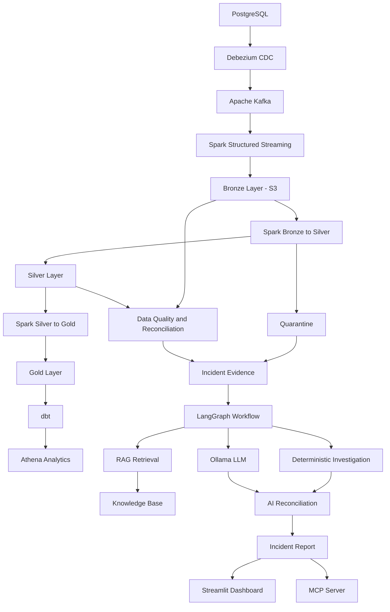

# StrataFlow

### Real-Time Data Engineering Platform with AI-Assisted Incident Intelligence

StrataFlow is an end-to-end data engineering project that captures database changes, processes streaming data, builds analytical data layers, and investigates data-quality incidents using deterministic checks and AI-assisted analysis.

It combines a CDC-driven data pipeline with an incident intelligence workflow that uses retrieval-augmented generation (RAG), a local LLM, and deterministic reconciliation.

**Repository:** https://github.com/Tanmesh86/strataflow

---

## 1. The problem

Data pipelines can fail in ways that are difficult to investigate:

- Invalid or incomplete records enter downstream processing.
- Related tables can become inconsistent.
- Failed records need to be isolated without losing evidence.
- Engineers need to understand why a validation or reconciliation check failed.
- LLM-generated explanations must be checked against actual pipeline evidence.

StrataFlow addresses these problems through a streaming data platform and a separate incident investigation workflow.

## 2. Architecture



The architecture separates data processing from incident interpretation. The data pipeline produces records and validation evidence; the AI workflow uses that evidence to produce an investigation report.

## 3. Data engineering pipeline

### Source and CDC

PostgreSQL acts as the operational source. Debezium captures database changes and publishes change events to Kafka topics.

The source tables include:

- customers
- products
- orders
- order_items
- payments

### Streaming ingestion

Spark Structured Streaming consumes Kafka events and writes the incoming data to the Bronze layer in S3.

### Bronze, Silver and Gold

| Layer | Responsibility |
|---|---|
| Bronze | Persist incoming CDC events for downstream processing |
| Silver | Apply business transformations and validation rules |
| Quarantine | Isolate rejected events and retain rejection information |
| Gold | Produce curated datasets for analytics |

The Silver transformation includes validation and quarantine handling. The Gold layer provides the curated output used by downstream analytics.

### Analytics

dbt models are used to build and validate Athena-facing analytical models. Airflow includes a DAG for Gold source validation, Athena model builds, and model validation.

## 4. Data quality and reconciliation

The data-quality checks cover record-level and cross-table validation.

Examples include:

- Not-null checks
- Primary-key checks
- Customer email uniqueness
- Product validation
- Order validation
- Order-item validation
- Payment validation
- Order-item total reconciliation
- Successful-payment reconciliation

Invalid events can be separated into quarantine rather than silently passing through the pipeline.

## 5. AI-assisted incident intelligence

The AI component investigates pipeline failures using actual validation and DLQ evidence.

### Investigation workflow

The LangGraph workflow contains these stages:

1. `load_inputs` — load incident and pipeline evidence.
2. `analyze_incident` — perform deterministic incident analysis.
3. `build_evidence` — construct evidence for the investigation.
4. `retrieve_knowledge` — retrieve relevant runbooks and historical failure knowledge.
5. `analyze_with_llm` — use Ollama to generate an incident analysis.
6. `save_report` — persist the resulting report.

### RAG knowledge retrieval

The RAG component ingests project knowledge, including:

- Historical cross-table failure information
- DLQ investigation and recovery runbooks

Knowledge is chunked, embedded, stored in a vector database, and retrieved to provide relevant context to the incident analysis.

### LLM analysis

Ollama runs the local language model used to generate an incident explanation.

The LLM receives structured evidence and retrieved knowledge. Raw DLQ records are not sent directly to the LLM.

### Deterministic reconciliation

LLM output is not treated as ground truth.

The reconciliation component checks generated analysis against deterministic evidence, including rejected-record counts and other evidence constraints. The report records whether the analysis reconciles or contains mismatches.

**Important limitation:** StrataFlow currently investigates and reports DLQ incidents. Automated DLQ replay and automatic correction of failed records are not implemented.

## 6. Dashboard and MCP interface

### Streamlit dashboard

The dashboard presents incident information through pages covering:

- Incident overview
- Failure patterns
- AI analysis
- Deterministic versus AI reconciliation
- Knowledge search

It reads the generated incident report and provides a way to inspect its evidence and reconciliation details. Its Search Knowledge action also invokes the RAG retriever to search the local knowledge base.

### MCP server

The MCP server exposes incident intelligence capabilities, including:

- Latest incident information
- Failure patterns
- AI analysis
- Reconciliation results
- Knowledge-base search

This provides a structured interface for accessing StrataFlow's incident information.

## 7. Technology stack

| Area | Technologies |
|---|---|
| Source database | PostgreSQL |
| CDC | Debezium |
| Messaging | Apache Kafka |
| Stream processing | Apache Spark, PySpark, Structured Streaming |
| Data lake | Amazon S3, Parquet |
| Analytics | dbt, Amazon Athena |
| Orchestration | Apache Airflow |
| Data quality | Python, SQL, reconciliation checks |
| AI orchestration | LangGraph |
| LLM | Ollama |
| RAG and vector retrieval | ChromaDB, embeddings |
| Dashboard | Streamlit |
| Integration interface | Model Context Protocol (MCP) |
| Infrastructure | Docker Compose, Terraform |
| Cloud | AWS |

## 8. AWS footprint

The project includes AWS-backed data storage and analytics components.

- **Amazon S3:** data lake storage for the pipeline layers and related data.
- **AWS Glue Data Catalog and crawlers:** catalog the Gold-layer S3 datasets.
- **Amazon Athena:** analytical query and dbt model execution target.
- **Terraform:** infrastructure definitions under `Infrastructure/Terraform`.

The streaming services and AI investigation components can run locally through Docker and local services. This keeps development and testing costs more manageable.

## 9. Repository structure

```text
StrataFlow/
├── AI/
│   ├── dashboard/
│   ├── investigator/
│   ├── mcp/
│   ├── orchestration/
│   ├── rag/
│   │   └── knowledge/
│   ├── rca/
│   └── reports/
├── AirFlow/
│   └── dags/
├── DataQuality/
│   ├── checks/
│   └── dlq/
├── Infrastructure/
│   └── Terraform/
├── Monitoring/
├── Spark/
├── pulseflow_dbt/
├── connector-v2.json
├── docker-compose.yml
├── .env.example
└── README.md
```

Generated reports, local vector-store data, checkpoints, Terraform state, and credentials are local runtime artifacts and should not be committed.

## 10. Local development setup

### Prerequisites

- Docker Desktop with Docker Compose
- Python
- Java 17 for Spark
- AWS CLI configured for the required AWS resources
- Terraform
- Ollama with the configured local model

### Configuration

Create local environment files from the supplied templates:

```powershell
if (-not (Test-Path .env)) { Copy-Item .env.example .env }
if (-not (Test-Path AirFlow/.env)) { Copy-Item AirFlow/.env.example AirFlow/.env }
```

Populate the required credentials and configuration locally. Do not commit either `.env` file.

Review the Compose files and environment variables before starting services.

### Start infrastructure services

```powershell
docker compose -f Infrastructure/docker-compose.yml up -d --no-build
```

### Start Airflow

After configuring the Airflow environment:

```powershell
docker compose -f AirFlow/docker-compose.yml up -d
```

The local Airflow web interface is configured on port `8081`. Before starting Airflow with Docker Compose, set `AWS_CREDENTIALS_DIR` to your local AWS configuration directory. In Windows PowerShell, use `$env:AWS_CREDENTIALS_DIR = "$HOME\.aws"`. The directory is mounted read-only at `/home/airflow/.aws` inside the Airflow worker.

### Start the AI dashboard

Activate the RAG virtual environment and start Streamlit:

```powershell
.\.venv-rag\Scripts\Activate.ps1
streamlit run AI/dashboard/app.py
```

The default Streamlit address is:

```text
http://localhost:8501
```

Additional Spark, dbt, and AI commands depend on the configured environment and the relevant project scripts.

## 11. Verified project outcomes

The development and verification work has included:

- A fresh CDC-to-Gold execution.
- Verification of actual Gold V2 output.
- Data-quality and reconciliation checks.
- Rejected-record handling and DLQ evidence.
- RAG retrieval against the project's knowledge base.
- LangGraph incident investigation.
- LLM analysis with deterministic reconciliation.
- A working Streamlit dashboard.
- A working local Spark 4.0.0 smoke test.

One verified data-quality run recorded 45/45 checks passing and 13 rejected records. These are results from that run, not a claim of a permanent production service-level guarantee.

## 12. Engineering considerations and limitations

- LLM analysis is an investigative aid, not an authority over pipeline data.
- Deterministic reconciliation is used to validate AI-generated findings.
- Automated DLQ replay is not implemented.
- The project is a portfolio and development platform, not a claim of production deployment at enterprise scale.
- Local services, AWS resources, credentials, and model availability must be configured before running the complete workflow.
- AWS resources may incur charges while provisioned or in use.

## 13. Future improvements

Potential extensions include:

- Controlled DLQ replay with idempotency and audit trails.
- More comprehensive pipeline observability and alerting.
- Additional failure-pattern detection.
- Automated incident notifications.
- Broader integration tests and repeatable deployment workflows.

---

## License

See [LICENSE](LICENSE).
